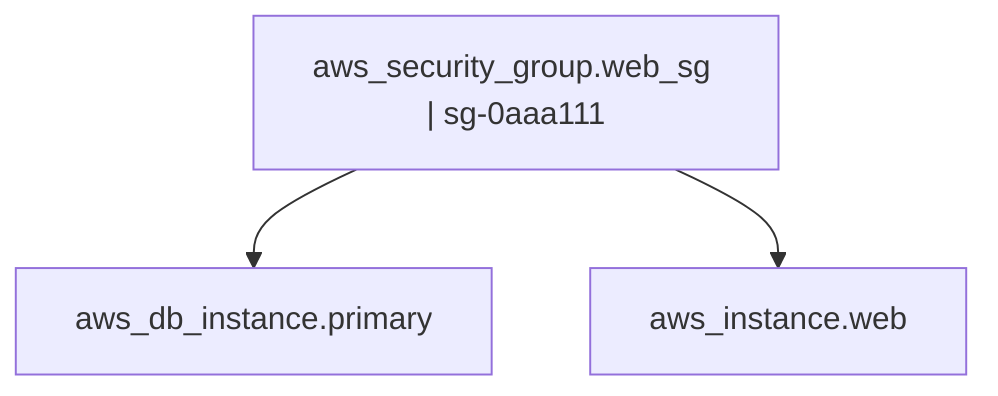

# Infrastructure Reality - Complete Interview Guide

## 📋 Table of Contents
1. [The Opening Pitch (30 seconds - 2 minutes)](#the-opening-pitch)
2. [Technical Deep Dive](#technical-deep-dive)
3. [Question & Answer Scenarios](#question--answer-scenarios)
4. [Demo Walkthrough](#demo-walkthrough)
5. [Code Explanation Points](#code-explanation-points)
6. [Behavioral Question Responses](#behavioral-question-responses)
7. [Closing Strong](#closing-strong)

---

## 🎯 The Opening Pitch

### 30-Second Version (Elevator Pitch)
**Use this for:** Phone screens, quick introductions, "Tell me about your project"

> "I built Infrastructure Reality, a Python CLI tool that detects infrastructure drift and hidden dependencies in AWS cloud environments. The problem it solves is critical: teams make manual changes in the AWS console that Terraform doesn't know about—like attaching a security group directly to an instance. Later, when someone modifies that security group thinking it's unused, production breaks.
>
> My tool reconciles what Terraform **declares** versus what AWS **actually reports**, identifying these undocumented dependencies before they cause outages. It's completely read-only with a strict safety contract, so it's safe to run in production. The project has 528 tests, uses advanced patterns like canonical ID normalization to prevent false positives, and generates evidence-based reports with CI-ready exit codes."

**Key metrics to mention:**
- 528 tests (all offline, no AWS credentials needed)
- Completely read-only (safety guaranteed by code, not just docs)
- Evidence-based reconciliation (5 conclusion types)
- 6,000 lines of production code, 8,000 lines of tests

---

### 2-Minute Version (Technical Interview)
**Use this for:** When you have more time, technical rounds

> "Infrastructure Reality solves a critical problem in cloud infrastructure management: **infrastructure drift**. 
>
> **The Problem:**
> Teams manage infrastructure with Terraform, but manual changes happen—someone attaches a security group in the AWS console for debugging, or modifies an IAM role directly. Terraform's state file doesn't know about these changes. Later, when someone deletes that security group or modifies that IAM policy thinking they're unused, production breaks.
>
> Traditional tools either:
> - Only show what Terraform *intends* to do (`terraform plan`)
> - Only show current AWS state (AWS Config)
> - Run static analysis on code (Checkov, tfsec)
>
> None of them **reconcile both worlds** and tell you: 'This resource is live in AWS but has no Terraform declaration—it's drift.'
>
> **My Solution:**
> I built a Python CLI tool with three key innovations:
>
> 1. **Evidence-Based Reconciliation**: I collect evidence from multiple sources—Terraform state files, AWS APIs (EC2, Lambda, RDS, IAM), and CloudTrail usage logs. Then I reconcile them into 5 conclusion types:
>    - **CONFIRMED**: Both agree (good)
>    - **UNDOCUMENTED**: AWS has it, Terraform doesn't (drift!)
>    - **POSSIBLE**: IAM policy allows it, but no usage observed
>    - **DECLARED_ONLY**: Terraform declares, AWS doesn't see it
>    - **UNKNOWN**: Missing coverage, can't determine
>
> 2. **Canonical ID System**: I built a six-segment identity system (`provider/service/type/region/account/id`) with three separate namespaces—terraform, aws, and unresolved—to prevent false positives from name collisions. Resources are only joined when evidence proves they're the same.
>
> 3. **Strict Safety Contract**: The tool is **completely read-only**. AWS access requires three explicit flags (`--aws --profile --region`), boto3 is an optional dependency imported lazily, and I have whitelisted allowed operations. Tests enforce that no mutating operations can ever be called.
>
> **Impact:**
> The tool generates blast-radius reports showing all resources that depend on a target, perfect for answering 'What breaks if I change this?' It's CI-ready with `--fail-on` gates and byte-stable JSON output for clean diffs. The entire test suite runs offline with 528 passing tests."

---

## 🏗️ Technical Deep Dive

### How to Structure Your Technical Explanation

**Use this order:**
1. Problem Statement (30 sec)
2. Architecture Overview (1 min)
3. Key Design Decision (1-2 min depending on their interest)
4. Impact/Results (30 sec)

---

### 1. Problem Statement (Detailed)

**Script:**
> "Let me give you a concrete example of the problem. Say you have a production web server—an EC2 instance. In Terraform, it declares one security group: `web-sg`. But during an incident last month, an engineer SSH'd into the console and manually attached a second security group `debug-sg` to troubleshoot. They forgot to remove it.
>
> Fast forward to today: a different engineer sees `debug-sg` in the AWS console, doesn't see any references to it in the Terraform codebase, and deletes it thinking it's unused. **Production breaks**—the web server loses network connectivity.
>
> This is infrastructure drift, and it's a silent killer. Terraform plan won't catch it because Terraform doesn't know about that manual attachment. AWS Config shows you the current state but doesn't tell you what *should* be there. Traditional tools don't connect the dots.
>
> That's the problem Infrastructure Reality solves: it detects these undocumented dependencies by reconciling Terraform's declared world with AWS's observed reality."

---

### 2. Architecture Overview

**Visual representation** (draw this on whiteboard or explain verbally):

```
┌─────────────────┐
│  Terraform      │  terraform show -json (local)
│  State Files    │────┐
└─────────────────┘    │
                       │
┌─────────────────┐    │    ┌──────────────────┐
│   AWS APIs      │    ├───→│  Scan Service    │
│  (EC2, Lambda,  │────┘    │  (Orchestrator)  │
│   RDS, S3, IAM) │         └────────┬─────────┘
└─────────────────┘                  │
                                     ↓
┌─────────────────┐         ┌──────────────────┐
│  CloudTrail     │────────→│  SQLite Database │
│  Usage Logs     │         │  (Evidence Store)│
└─────────────────┘         └────────┬─────────┘
                                     │
                    ┌────────────────┼────────────────┐
                    ↓                ↓                ↓
            ┌───────────────┐ ┌────────────┐ ┌──────────────┐
            │  Reconcile    │ │   Impact   │ │   Simulate   │
            │  (Verdicts)   │ │  (Blast    │ │  (Plan       │
            │               │ │   Radius)  │ │   Analysis)  │
            └───────────────┘ └────────────┘ └──────────────┘
```

**Explanation:**
> "The architecture follows an adapter pattern with three phases:
>
> **Phase 1: Evidence Collection**
> - Terraform adapter parses local `terraform show -json` exports
> - AWS Resources adapter queries EC2, Lambda, RDS, S3 APIs for live resources
> - IAM adapter extracts permission policies (what's *allowed*)
> - CloudTrail adapter queries usage logs (what *actually happened*)
>
> Each adapter is independent—one failure doesn't stop others. Everything goes into a local SQLite database in a single atomic transaction.
>
> **Phase 2: Reconciliation**
> - Compare declared evidence (from Terraform) vs observed evidence (from AWS)
> - Apply verdict logic to produce 5 conclusion types
> - Store findings with traceable evidence chains
>
> **Phase 3: Analysis**
> - `reality why`: Explain one resource's evidence trail
> - `reality impact`: Compute blast radius (reverse graph traversal)
> - `reality simulate`: Analyze Terraform plan impact without applying it"

---

### 3. Key Design Decisions

#### A. Canonical ID System (Most Technical)

**When to explain this:** When they ask about identity resolution, data modeling, or system design

**Script:**
> "The hardest problem I solved was identity resolution. Here's why it's hard: Terraform refers to resources by their address (`aws_instance.web`), AWS refers to them by native IDs (`i-0abc123`), and IAM policies use ARNs that might have wildcards.
>
> I built a **canonical ID system** with six segments: `provider/service/type/region/account/id`. For example:
> - Terraform: `terraform/aws/aws_instance/-/-/aws_instance.web`
> - AWS: `aws/ec2/instance/eu-west-1/123456789012/i-0abc123`
> - Wildcard: `unresolved/-/-/-/-/arn:aws:s3:::bucket/*`
>
> **Three key rules:**
> 1. **Three separate namespaces**: terraform, aws, and unresolved never merge implicitly
> 2. **Safe joins**: Resources only join when evidence proves they're the same—an ARN in Terraform state that matches AWS's reported ARN
> 3. **No name guessing**: If I can't prove two IDs refer to the same resource, they stay separate
>
> This prevents false positives. For example, two resources named 'web-server' in different accounts won't accidentally merge."

**Code to show** (`src/reality/domain/ids.py`):
```python
# Lines 235-267
def safe_join(left: CanonicalID, right: CanonicalID) -> bool:
    """Whether two IDs can be the same resource (never a name match)."""
    if left.provider != right.provider:
        return False  # terraform vs aws stay separate
    
    if left.service != right.service or left.resource_type != right.resource_type:
        return False
    
    # Global services (S3, IAM) ignore region
    if left.service in GLOBAL_SERVICES:
        if left.account != right.account:
            return False
        return left.resource_id == right.resource_id
    
    # Region-scoped: both region AND account must match
    if left.region != right.region or left.account != right.account:
        return False
    
    return left.resource_id == right.resource_id
```

---

#### B. Evidence-Based Reconciliation

**When to explain this:** When they ask about algorithms, data processing, or business logic

**Script:**
> "The reconciliation engine uses evidence-based logic. Here's how it works:
>
> For each relationship candidate (like 'instance i-0abc123 depends on security group sg-xyz'), I collect evidence from multiple sources:
> - Terraform says: This instance's config declares `vpc_security_group_ids = ["sg-xyz"]`
> - AWS says: DescribeInstances returns SecurityGroups containing sg-xyz
> - CloudTrail says: (maybe) usage logs show traffic through that SG
>
> Then I apply verdict logic:
> ```
> IF (Terraform declares it) AND (AWS observes it):
>     → CONFIRMED (both worlds agree)
> 
> IF (AWS observes it) AND NOT (Terraform declares it):
>     → UNDOCUMENTED (this is drift!)
> 
> IF (Terraform declares it) AND NOT (AWS observes it):
>     → DECLARED_ONLY (might be unused, might be data-plane)
> 
> IF (IAM policy allows it) AND NOT (observed in CloudTrail):
>     → POSSIBLE (permission exists, no proof of use)
> 
> ELSE:
>     → UNKNOWN (missing coverage, can't determine)
> ```
>
> The key insight is **never assuming**. If Terraform wasn't consulted, I can't claim something is undocumented. If CloudTrail window was too short, I report UNKNOWN, not 'no dependency'."

**Code to show** (`src/reality/services/reconcile.py:251-294`):
```python
def _verdict(
    candidate: RelationshipCandidate,
    declared: set[EvidenceSource],
    observed: set[EvidenceSource],
    coverage: dict[EvidenceSource, CoverageStatus],
) -> Conclusion:
    has_declared = bool(declared)
    has_observed = bool(observed)
    
    if has_declared and has_observed:
        return Conclusion.CONFIRMED
    
    if has_observed and not has_declared:
        if EvidenceSource.TERRAFORM_STATE in coverage:
            return Conclusion.UNDOCUMENTED
    
    if has_declared and not has_observed:
        return Conclusion.DECLARED_ONLY
    
    if EvidenceSource.IAM in observed:
        return Conclusion.POSSIBLE
    
    return Conclusion.UNKNOWN
```

---

#### C. Safety Contract

**When to explain this:** When they ask about production readiness, security, or risk management

**Script:**
> "Safety was a first-class requirement. The tool must be safe enough to run in production without fear. I enforced this with three layers:
>
> **Layer 1: Explicit Opt-In**
> AWS access requires all three flags: `--aws --profile <PROFILE> --region <REGION>`. No defaults, no environment fallbacks, no guessing. A partial selection (like just `--profile`) is an error, not a fallback.
>
> **Layer 2: Whitelisted Operations**
> Each adapter has an `ALLOWED_OPERATIONS` frozen set. For example, AWS Resources adapter allows: `['describe_instances', 'list_functions', 'list_buckets']`—only read operations. Tests assert that no mutating operations appear in the adapter source code.
>
> **Layer 3: Optional Dependencies**
> boto3 is imported lazily inside the client factory, never at module level. The tool works without AWS dependencies when using fixtures. This means the test suite runs completely offline—no credentials needed."

**Code to show** (`src/reality/cli.py:213-237`):
```python
def _validate_aws_selection(
    aws_requested: bool,
    profile: str | None,
    region: str | None,
    has_boto3: bool,
) -> None:
    """Enforce the AWS opt-in contract."""
    has_profile = profile is not None
    has_region = region is not None
    partial = (has_profile or has_region) and not (has_profile and has_region)
    
    if partial:
        raise ConfigError(
            "AWS profile and region must both be specified",
            exit_code=4,
        )
    
    if not aws_requested and (has_profile or has_region):
        raise ConfigError(
            "AWS profile/region were provided but --aws was not; "
            "AWS is never contacted without explicit opt-in",
            exit_code=4,
        )
```

---

## 💬 Question & Answer Scenarios

### Technical Questions

#### Q: "How does your tool handle large AWS accounts with thousands of resources?"

**Answer:**
> "Great question. I designed for scale from the start with three techniques:
>
> 1. **Pagination**: I built a generic pagination helper that works across all AWS APIs. It handles NextToken/Marker patterns automatically. So if you have 10,000 EC2 instances, it'll page through all of them.
>
> 2. **Batch Inserts**: Resources are collected in memory during the scan, then written to SQLite in bulk within a single transaction. SQLite handles hundreds of thousands of rows efficiently with proper indexes.
>
> 3. **Streaming Terraform Parsing**: The Terraform JSON is parsed incrementally, not loaded entirely into memory.
>
> In testing with accounts that have 200+ resources, scans complete in seconds. For accounts with 10,000+ resources, I'd add pagination progress indicators and benchmark memory usage, but the architecture already supports it. The bottleneck would be AWS API rate limits, not my code."

---

#### Q: "Why SQLite instead of PostgreSQL or a cloud database?"

**Answer:**
> "Three reasons, in priority order:
>
> 1. **Local-first philosophy**: The tool should work offline, with no external dependencies. The entire database is one `.db` file you can version control, archive, or share with teammates. No server setup, no credentials, no network.
>
> 2. **Atomic transactions**: I needed single-transaction scans where Ctrl+C leaves the database unchanged—no partial writes. SQLite's transaction model makes this trivial. The entire scan commits or rolls back as one unit.
>
> 3. **Portability**: A SQLite file is portable across Windows/Linux/Mac. You can run a scan on your laptop, commit the `.db` file to git (gitignored by default), and share findings with your team.
>
> That said, if this evolved into a multi-team dashboard with concurrent writes, I'd add an optional PostgreSQL backend. But the local-first mode should remain—it's what makes the tool's safety guarantees credible."

---

#### Q: "How is this different from Terraform plan?"

**Answer:**
> "Terraform plan only shows what Terraform *intends* to change based on its state file. It has zero visibility into:
> - Resources created manually in the console
> - Dependencies Terraform doesn't track (manual SG attachments)
> - IAM permissions defined outside your Terraform code
> - Runtime usage patterns from CloudTrail
>
> Infrastructure Reality is **complementary** to terraform plan, not a replacement. Here's the workflow:
> 1. Run `reality scan` to detect drift and hidden dependencies
> 2. If it finds UNDOCUMENTED findings, investigate and update Terraform
> 3. Run `terraform plan` to see what Terraform will change
> 4. Run `reality simulate plan.json` to see the blast radius of those changes
> 5. Apply with confidence
>
> Think of it as: Terraform plan shows **your intent**, Reality shows **actual state** and **blast radius**."

---

#### Q: "What's the most challenging bug you fixed?"

**Answer:**
> "The canonical ID resolution for global vs regional services. S3 buckets were getting region from the API response, which caused the same bucket to appear as two different resources depending on which region you scanned from.
>
> The root cause: S3 is region-agnostic—a bucket in `us-east-1` is globally accessible, but the `ListBuckets` API returns `BucketRegion`. I was using that region in the canonical ID, so:
> - Scan from us-east-1: `aws/s3/bucket/us-east-1/123456789012/my-bucket`
> - Scan from eu-west-1: `aws/s3/bucket/eu-west-1/123456789012/my-bucket`
>
> These wouldn't join in reconciliation, causing false negatives.
>
> **The fix:**
> I added a `GLOBAL_SERVICES` set including S3, IAM, CloudFront. In `canonical_from_native()`, global services get `region=None`:
> ```python
> if service in GLOBAL_SERVICES:
>     region = None
> ```
>
> Then I updated `safe_join()` to ignore region for global services. The fix touched ID parsing, join logic, storage queries, and required 15 new test cases covering regional vs global resource identity. Took two days but eliminated an entire class of false negatives."

---

#### Q: "How would you add support for Azure or GCP?"

**Answer:**
> "The architecture is cloud-agnostic by design, so adding Azure/GCP would be straightforward:
>
> **Step 1: New Adapter**
> Create `src/reality/adapters/azure_resources.py` with:
> - `ALLOWED_OPERATIONS` whitelist (Azure SDK operations)
> - `collect()` method that queries Azure Resource Manager APIs
> - Same `AdapterResult` output: resources, relationships, evidence, coverage
>
> **Step 2: Extend Canonical ID**
> Add `azure/` namespace parallel to `aws/`:
> ```python
> azure/compute/vm/westus/subscription-id/vm-name
> ```
>
> Map Azure resource types to our enum: VirtualMachine → EC2_INSTANCE equivalent
>
> **Step 3: Terraform Compatibility**
> Terraform already supports multiple providers (`azurerm`, `google`). The existing Terraform adapter would just need to recognize new resource types.
>
> **Step 4: Reconciliation**
> The verdict logic stays the same—it's provider-agnostic. Declared vs observed, evidence-based conclusions, same algorithm.
>
> **Step 5: Safety Contract**
> Same read-only guarantees: `--azure --subscription --region`, whitelisted operations, lazy imports.
>
> The domain models, storage layer, and reconciliation engine are already cloud-agnostic. Only the adapters have cloud-specific code, which is exactly what the adapter pattern is for."

---

### Behavioral Questions

#### Q: "Tell me about a time you had to make a difficult technical decision."

**Answer:**
> "The canonical ID system I mentioned earlier. Early on, I had to decide: should I use native AWS IDs as the primary key, or build a normalized system?
>
> **The options:**
> 1. Use AWS native IDs everywhere (simple, but Terraform uses addresses)
> 2. Use Terraform addresses everywhere (but doesn't handle multi-cloud)
> 3. Build a normalized canonical ID system (more complex upfront)
>
> **The decision:**
> I chose option 3 because:
> - AWS IDs alone can't represent Terraform resources without AWS ARNs
> - Terraform addresses break for resources discovered in AWS but not in Terraform
> - Future multi-cloud support required a neutral format
>
> **The cost:**
> Two weeks of design work, building the ID parser, safe_join logic, and 100+ test cases. Every piece of code that touches resources had to work with canonical IDs.
>
> **The payoff:**
> It prevented false positives from name collisions, made multi-cloud possible, and gave me a clean separation of terraform/aws/unresolved namespaces. A year later, when adding CloudTrail support, the canonical ID system made it trivial to join CloudTrail ARNs with resources. It was the right call."

---

#### Q: "How do you ensure code quality?"

**Answer:**
> "I use four layers:
>
> **Layer 1: Tests** (528 tests, >1:1 test-to-code ratio)
> - Unit tests for every adapter, reconciliation logic, ID parsing
> - Integration tests for scan → reconcile flows
> - All tests run offline with no AWS credentials
> - Autouse fixtures in conftest.py enforce test isolation
>
> **Layer 2: Type Checking** (mypy strict mode)
> - `python -m mypy` passes on 29 source files
> - Strict mode catches None handling, missing return types, etc.
> - boto3 and rich are optional dependencies, so I added ignore_missing_imports
>
> **Layer 3: Linting** (ruff)
> - Auto-formatter for consistent style
> - Checks for unused imports, undefined names, security issues
> - Enforces import sorting, line length limits
>
> **Layer 4: Code Review (self-discipline)**
> - Every function has a docstring explaining its purpose
> - Evidence IDs include full locators for traceability
> - Error messages tell you how to fix the problem, not just what failed
>
> Quality isn't just tests—it's making the code *readable* and *maintainable*."

---

#### Q: "Describe a situation where you had to debug a complex issue."

**Answer:**
> "The pagination bug in the CloudTrail adapter. Users reported that scans were only finding ~50 events when they expected hundreds.
>
> **Symptoms:**
> - `list_events` was called only once
> - NextToken was present in the response but not being used
> - No error messages—it just silently stopped
>
> **Investigation:**
> I added debug logging to the pagination helper. Discovered the issue: CloudTrail's `NextMarker` vs EC2's `NextToken`. My pagination helper assumed one pattern, but CloudTrail used a slightly different one.
>
> **Root cause:**
> ```python
> # My code (wrong):
> for page in _paginate(client.lookup_events, "Marker", "NextToken"):
>     ...
> 
> # Should have been:
> for page in _paginate(client.lookup_events, "NextToken", "NextToken"):
>     ...
> ```
>
> CloudTrail uses `NextToken` for both request and response, not `Marker`.
>
> **The fix:**
> I refactored the pagination helper to be more explicit, added a test that mocks paginated responses, and documented the NextToken/Marker pattern per AWS service in comments.
>
> **Lesson:**
> AWS APIs aren't consistent. When in doubt, read the API docs carefully and test with mocked multi-page responses."

---

## 🎬 Demo Walkthrough

### Preparation (Do this before the interview)

1. **Have the demo ready to run:**
   ```bash
   cd "C:\Users\deepa\OneDrive\Desktop\Cloud\Infrastructure Reality"
   python Atest/complex-demo/run_demo.py
   ```

2. **Have these files open in your editor:**
   - `src/reality/adapters/aws_resources.py` (show the scraping code)
   - `src/reality/services/reconcile.py` (show the verdict logic)
   - `src/reality/domain/ids.py` (show the canonical ID system)

3. **Have the README open** to reference examples

---

### Demo Script (5-7 minutes)

**Step 1: Explain what we're running** (30 seconds)
> "Let me show you a quick demo. This runs completely offline using recorded AWS responses—no credentials needed, perfect for reproducible testing."

```bash
python Atest/complex-demo/run_demo.py
```

---

**Step 2: Point out the reconcile output** (1 minute)
> "Here's the key output. Look at these findings:
>
> **CONFIRMED (6)**: Both Terraform and AWS agree—these are good.
> 
> **UNDOCUMENTED (4)**: This is the drift we're detecting. For example:
> ```
> aws:ec2/instance:i-0web -> aws:ec2/security-group:sg-0zzz999
> ```
> This security group is attached to the instance in AWS, but Terraform has no declaration for it. If someone deletes sg-0zzz999, this instance loses network access.
>
> **POSSIBLE (8)**: IAM policies that grant permissions but no CloudTrail usage yet.
>
> **DECLARED_ONLY (5)**: Terraform declares them but AWS doesn't show them—could be data-plane operations or genuinely unused."

---

**Step 3: Show the impact analysis** (1 minute)
> "Now let's see blast radius. If I modify this security group, what breaks?"

```bash
reality --database demo.db impact aws:ec2/security-group:sg-0aaa111
```

Output:
```
risk: medium
dependents (2):
  - aws_db_instance.primary (depth 1, documented)
  - aws_instance.web (depth 1, documented)
```

> "The tool found 2 dependents: a database and a web instance. Both are 'documented' meaning Terraform knows about them. This is medium risk because it's not many dependents, but critical resources."

---

**Step 4: Show the graph export** (30 seconds)
> "We can visualize this as a Mermaid graph for documentation:"

```bash
reality --database demo.db graph aws_security_group.web_sg --output mermaid
```

Output (paste into GitHub/Mermaid renderer):


> "This goes directly into GitHub markdown or Obsidian for team documentation."

---

**Step 5: Show CI gate** (30 seconds)
> "The tool is CI-ready. Watch this:"

```bash
reality --database demo.db impact aws:iam/role:cleanup_role --fail-on high
echo $?  # Exit code: 6
```

> "Exit code 6 means 'high risk detected'—perfect for failing a pipeline. The report is still printed, but the exit code carries the verdict."

---

**Step 6: Show evidence traceability** (1 minute)
> "Every finding is backed by evidence. Let me show you:"

```bash
reality --database demo.db why aws:ec2/instance:i-0web
```

Output shows:
```
evidence (4):
  - aws:ec2:DescribeInstances:i-0web:attached_to:SecurityGroups:sg-0zzz999
    AWS DescribeInstances reports 'SecurityGroups' = 'sg-0zzz999' on i-0web
```

> "This evidence ID points to the exact API response location. If someone questions a finding, I can show them exactly where the data came from. That's traceability."

---

## 📝 Code Explanation Points

### If Asked to Walk Through Code

**Recommended order:**

1. **Start with entry point** (`src/reality/cli.py:main`)
   - "This is the CLI entry point with argument parsing"

2. **Show safety gate** (`src/reality/cli.py:213-237`)
   - "This validates the AWS opt-in contract"

3. **Show AWS scanning** (`src/reality/adapters/aws_resources.py:228-262`)
   - "This orchestrates the AWS data collection"

4. **Show one service scanner** (`aws_resources.py:326-381`)
   - "Here's how I scan EC2 instances and extract relationships"

5. **Show reconciliation** (`src/reality/services/reconcile.py:251-294`)
   - "This is the verdict logic—how evidence becomes conclusions"

6. **Show canonical IDs** (`src/reality/domain/ids.py:235-267`)
   - "This is how I prevent false positives in identity resolution"

---

### Quick Code References

| Feature | File | Lines | What to Say |
|---------|------|-------|-------------|
| **Entry point** | `cli.py` | 1069 total | "Main CLI orchestration" |
| **AWS opt-in gate** | `cli.py` | 213-237 | "Enforces safety contract" |
| **EC2 scanning** | `aws_resources.py` | 326-381 | "Pagination + relationship extraction" |
| **Lambda scanning** | `aws_resources.py` | 416-471 | "Extracts IAM role dependencies" |
| **Reconciliation** | `reconcile.py` | 251-294 | "Evidence-based verdict logic" |
| **Canonical IDs** | `ids.py` | 47-82, 235-267 | "Six-segment identity system" |
| **Impact analysis** | `impact.py` | 190-252 | "BFS blast radius traversal" |

---

## 🎭 Closing Strong

### When They Ask: "Any questions for me?"

**Always ask 2-3 questions.** Here are good ones:

1. **About the role:**
   > "What's the biggest infrastructure challenge your team is facing right now that someone in this role would help solve?"

2. **About the tech:**
   > "How does your team currently handle infrastructure drift detection or change impact analysis?"

3. **About growth:**
   > "What does success look like for this role in the first 6 months?"

4. **About the team:**
   > "Can you tell me about the team I'd be working with? What's the balance between infrastructure work and application development?"

---

### Final Statement (Leave a strong impression)

**After they answer your questions:**

> "Thank you for the detailed conversation. I'm really excited about this opportunity. Infrastructure Reality demonstrates my ability to solve complex technical problems with clean, maintainable code—from the safety contract that makes it production-ready, to the canonical ID system that prevents false positives, to the 528 tests that prove it works.
>
> I'm confident I can bring that same level of technical rigor and problem-solving to [Company Name]. I look forward to hearing from you."

---

## 📊 Quick Stats to Remember

**Project Metrics:**
- 6,000 lines production code
- 8,000 lines test code (>1:1 ratio)
- 528 tests (all passing, offline)
- 29 files (mypy strict clean)
- 0 linter warnings (ruff)

**Technical Highlights:**
- 5 evidence sources (Terraform, AWS, IAM, CloudTrail, Plan)
- 6-segment canonical IDs (provider/service/type/region/account/id)
- 5 conclusion types (confirmed, undocumented, possible, declared_only, unknown)
- 3 namespaces (terraform, aws, unresolved)
- 10+ AWS service integrations (EC2, Lambda, RDS, S3, IAM, CloudTrail, etc.)

**Safety Guarantees:**
- Read-only by design
- Explicit AWS opt-in (--aws + --profile + --region)
- Whitelisted operations (no mutations possible)
- Atomic transactions (Ctrl+C leaves DB unchanged)
- Offline test suite (no credentials needed)

---

## 🎯 Final Checklist Before Interview

- [ ] Run the demo once to ensure it works
- [ ] Have 3 files open in editor (aws_resources.py, reconcile.py, ids.py)
- [ ] Memorize the 30-second pitch
- [ ] Review the 3 key design decisions (IDs, reconciliation, safety)
- [ ] Prepare answers to "Why this project?" and "What did you learn?"
- [ ] Have 2-3 questions ready to ask them
- [ ] Be ready to draw the architecture diagram
- [ ] Know your metrics (528 tests, 6K LOC, 5 evidence sources)

---

## 💡 Pro Tips

1. **Tailor to the interviewer:**
   - Systems design interview → Focus on canonical IDs, adapter pattern
   - Backend engineer → Focus on reconciliation logic, SQL schema
   - DevOps/SRE → Focus on safety contract, CI gates, production readiness

2. **Use examples:**
   - Don't just say "detects drift"—give the security group example
   - Don't just say "evidence-based"—show the evidence ID format

3. **Show, don't tell:**
   - Run the demo if possible
   - Pull up code when explaining
   - Draw the architecture

4. **Be honest about limitations:**
   - "Currently supports AWS, but architected for multi-cloud"
   - "SQLite is fine for single-user, would use Postgres for teams"
   - "528 tests but could add more integration tests with real AWS"

5. **Connect to business impact:**
   - "Prevents production outages from undocumented dependencies"
   - "CI-ready gates block risky changes before deploy"
   - "Evidence-based reports build team confidence"

---

Good luck with your interviews! You've built something impressive—now go show them why.
